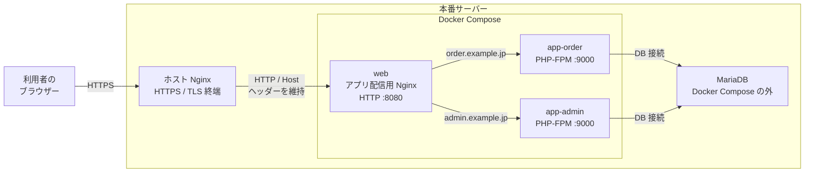

# 本番サーバーへの配置

本番では、実サーバー上の Nginx が TLS 終端とリバースプロキシを担当し、
Laravel/PHP-FPM とアプリ配信用 Nginx を Docker Compose で起動します。
MariaDB は本番サーバー内で稼働させますが、この Docker Compose には含めません。
開発用の [compose.yaml](../docker/compose.yaml) とは別の構成です。

## 本番サーバーの構成



構成の役割や補足は[本番構成の説明](./production-architecture.md)を参照してください。

発注側と受注・システム管理側は、同じリポジトリ・同じアプリケーションコードから
ビルドした PHP-FPM アプリ環境を `app-order` と `app-admin` として起動します。
1つのアプリ配信用 Nginx が Host 名で転送先を選び、ホスト側 Nginx はTLS終端後に
共通のアプリ配信用 Nginx へプロキシします。各 app 環境のログイン入口・セッションを
分離し、両環境は発注・受注データを共通DBで扱います。この分離はDBや障害・侵害の
影響範囲を分離するものではありません。

[compose.production.yaml](../docker/compose.production.yaml) は、開発環境と同じ二環境構成です。
共通の `web`（アプリ配信用 Nginx）、`app-order`、`app-admin` を定義し、
両 app は同じイメージから起動して本番サーバー内の MariaDB へ接続します。
発注側・管理側の設定ファイルは `docker/production/order.env` と
`docker/production/admin.env` に分け、Compose の `env_file` で対応する app にだけ
環境変数として渡します。`.env` ファイル自体をコンテナへボリュームマウントしません。
設定ファイルの所有者・読み取り権限を制限し、Gitへ登録しないでください。

Host 名による振り分けは [production.conf.template](../docker/nginx/production.conf.template) で
定義し、`docker/production/web.env` の `APP_HOST_ORDER` / `APP_HOST_ADMIN` を
コンテナ起動時に埋め込みます。どちらの Host 名にも一致しないリクエストは拒否します。

## 前提とセキュリティ

- 実サーバーに Docker Engine、Docker Compose v2、Nginx がインストール済みであること。
  Ubuntu 24.04 LTS への Docker 導入は[サーバー準備手順](./deployer.md#本番サーバーへの-docker-導入ubuntu-2404-lts)を参照してください。
- ドメインと TLS 証明書はホスト側 Nginx に設定すること。
- MariaDB は本番サーバー内で稼働させ、インターネットへ公開しないこと。
- DB ポートや PHP-FPM ポートは Docker のホストポートとして公開しません。
  Web コンテナの公開先も `127.0.0.1:8080` に限定します。
- `docker/production/` の各設定ファイルには本番用の秘密情報を設定し、Git にコミットしないでください。
- `APP_KEY` は一度設定した後、再生成・変更しないでください。既存の暗号化データに影響します。
- 発注側・管理側でセッションCookie名、キャッシュ名前空間、ログ識別子、ファイル保存領域を分けてください。
- `APP_KEY` を環境ごとに分ける場合、Laravelで暗号化した共通DB内の値は相互に復号できません。
  共通の暗号化データがある場合は、鍵の共有範囲とローテーションを別途設計してください。
- 両環境が同じDBを参照するため、各リクエストで所属・権限をサーバー側で検証してください。
- 発注側・管理側の設定ファイルを別々に配置し、Compose の `env_file` から対応する app にだけ渡してください。
  設定ファイルそのものをコンテナにマウントせず、ファイルのアクセス権を制限してください。

## 初回配置

プロジェクトをサーバーに配置し、プロジェクトルートで実行します。

```bash
cp -n docker/production/order.env.example docker/production/order.env
cp -n docker/production/admin.env.example docker/production/admin.env
cp -n docker/production/web.env.example docker/production/web.env
chmod 600 docker/production/*.env
```

`order.env` / `admin.env` の `APP_URL` を各環境の実際の HTTPS URL に、
`DB_HOST` / `DB_PORT` / `DB_DATABASE` / `DB_USERNAME` / `DB_PASSWORD` を
本番サーバー内の MariaDB に接続する値に変更します。Compose 内のアプリから到達できる
ホスト名・アドレスを `DB_HOST` に指定してください。`APP_DEBUG=false` は本番で有効にしないでください。
DBユーザーには必要なデータベースだけへの権限を付与してください。
`SESSION_COOKIE` / `SESSION_DOMAIN` / `CACHE_PREFIX` は環境ごとに別の値を維持します。
`APP_PORTAL` は Compose から渡すため、設定ファイルには記載しません。

`web.env` の `APP_HOST_ORDER` / `APP_HOST_ADMIN` には、ホスト Nginx が転送してくる
実際のドメイン名を設定します。この値が各 app への振り分け条件になります。

GitHub Container Registry (GHCR) からイメージを取得します。イメージが非公開の場合は、
`read:packages` 権限を持つトークンを使って事前に `docker login ghcr.io` を実行してください。
リリースタグを指定してから、Compose でイメージを取得します。

```bash
export IMAGE_TAG=v1.2.3
docker compose -f docker/compose.production.yaml pull
```

GitHub Actions の [release-images.yml](../.github/workflows/release-images.yml) は、
`v*` 形式のタグ（例: `v1.2.3`）を push すると、本番用の `app` / `web` イメージを
それぞれ `ghcr.io/sugitanisystem/ltbs/app:v1.2.3`、
`ghcr.io/sugitanisystem/ltbs/web:v1.2.3` として GHCR に公開します。
このワークフローはイメージのビルド・公開までを行い、本番サーバーへのデプロイは行いません。
両イメージの公開成功後に GitHub Release を作成します。`-` を含むタグは Prerelease とし、
タグ省略時の最新正式 Release の選択対象から除外します。
本番 Compose は `IMAGE_TAG` で指定したリリースタグのイメージを取得します。
タグを変更して更新するときは、`IMAGE_TAG` を新しいタグに設定して `pull` してください。

アプリイメージのビルド中は、Composer の `package:discover` が Laravel を初期化するため、
`composer install` の実行時だけ `APP_PORTAL=order` を指定します。
この値はイメージの環境変数として保存せず、設定・ルートのキャッシュも生成しません。
起動時には Compose が各 app に渡す `APP_PORTAL` に従って発注側・管理側を切り替えます。

APP_KEY を生成し、表示された値を各設定ファイルの `APP_KEY` に設定します。
Laravelの暗号化も分離する場合は、発注側と管理側で同じキーを使い回さないでください。
一方の環境でLaravelにより暗号化された値は、他方の環境では復号できません。
共通の暗号化データを扱う場合は、鍵の共有範囲を運用設計で定めてください。

```bash
docker compose -f docker/compose.production.yaml run --rm app-order php artisan key:generate --show
docker compose -f docker/compose.production.yaml run --rm app-admin php artisan key:generate --show
```

MariaDB への接続を確認した上で、共通DBへのマイグレーションを一度だけ実行します。
本番データに変更を加えるため、実行前に DB のバックアップを取得してください。
`app-order` だけから実行し、`app-admin` から重複して実行しないでください。

```bash
docker compose -f docker/compose.production.yaml run --rm app-order php artisan migrate --force
docker compose -f docker/compose.production.yaml up -d
```

## ホスト Nginx の設定

発注側・管理側それぞれのドメイン用 `server` ブロック（TLS 証明書を設定済み）に、
[host-proxy-location.conf.example](../docker/nginx/host-proxy-location.conf.example)
の `location /` を配置します。転送先はどちらも同じ `127.0.0.1:8080` で、
`Host` ヘッダーをそのまま渡すことでアプリ配信用 Nginx が app を選びます。例:

```nginx
server {
    listen 443 ssl;
    server_name order.example.jp;

    # ssl_certificate と ssl_certificate_key はサーバーの証明書に合わせて設定

    location / {
        proxy_pass http://127.0.0.1:8080;
        proxy_http_version 1.1;
        proxy_set_header Host $host;
        proxy_set_header X-Real-IP $remote_addr;
        proxy_set_header X-Forwarded-For $remote_addr;
        proxy_set_header X-Forwarded-Host $host;
        proxy_set_header X-Forwarded-Port $server_port;
        proxy_set_header X-Forwarded-Proto $scheme;
        proxy_read_timeout 60s;
    }
}
```

管理側は `server_name admin.example.jp;` として同じ内容の `server` ブロックを追加します。
ドメイン名は `server_name`、各設定ファイルの `APP_URL` / `SESSION_DOMAIN`、
`web.env` の `APP_HOST_ORDER` / `APP_HOST_ADMIN` のすべてで一致させます。
設定を反映する前に構文を確認してください。

```bash
sudo nginx -t
sudo systemctl reload nginx
```

アプリ配信用 Nginx はコンテナ内で静的ファイルを配信し、PHP リクエストを
PHP-FPM に渡します。Laravel は転送された HTTPS / クライアント情報を解釈するため、
本番アプリの HTTP ポートや PHP-FPM ポートを外部に公開しないでください。

## 更新

新しいリリースタグを `IMAGE_TAG` に設定し、GHCR からイメージを取得します。
必要なマイグレーションを確認・一度だけ実行してから両方のアプリ環境を更新します。
DBの変更前にはバックアップを取得します。
更新中に旧・新バージョンが共通DBへ同時に接続する可能性を考慮し、
後方互換性を保つ段階的なスキーマ変更を行います。

```bash
export IMAGE_TAG=v1.2.4
docker compose -f docker/compose.production.yaml pull
docker compose -f docker/compose.production.yaml run --rm app-order php artisan migrate --force
docker compose -f docker/compose.production.yaml up -d
docker compose -f docker/compose.production.yaml logs -f web app-order app-admin
```

## デプロイ自動化（次回対応）

実際の本番反映では PHP Deployer の利用を検討します。Deployer から SSH で本番サーバーへ接続し、
サーバー上で GHCR の Compose イメージを pull して起動・更新する想定です。
[Docker での Deployer 実行環境と SSH 接続設定例](./deployer.md)を用意しています。
Release の解決・確認タスクとサーバーの `~/.ltbs-github-token` の配置手順は
[Deployer の手順](./deployer.md#release-の解決確認)を参照してください。
GHCR 認証、デプロイ・ロールバック処理はまだ実装していません。

デプロイ時に「直近のイメージ」を使う運用を想定しています。ただし `latest` だけを参照すると、
障害時に直前に動いていたイメージを特定・再取得しづらくなるため、Actions が公開したリリースタグ
（例: `v1.2.3`）をデプロイ単位で記録し、Compose の `IMAGE_TAG` に明示する方法を推奨します。
最新版を反映するときも、対象のリリースタグを選択してデプロイしてください。

不具合時に直前の `IMAGE_TAG` へ戻して再 pull・再起動できるよう、Deployer のリリース履歴などに
稼働中と直前のタグを記録する必要があります。イメージのロールバックだけでは DB マイグレーションは
巻き戻らないため、マイグレーションは後方互換性を保ち、復旧手順と DB バックアップを別途考慮します。
本番サーバーの GHCR 認証には、pull のみに必要な権限を与えた認証情報を安全に保管してください。

Laravel のログは Docker の標準エラー出力に送られます。
`storage/` は環境ごとに `order_storage` / `admin_storage` ボリュームへ分離し、
双方から扱う業務ファイルは `business_files` ボリュームを `/shared/business-files` に
共有マウントします（Laravel の `business_shared` ディスク）。共有ファイルは Nginx から
直接公開せず、所属と権限を検証する Laravel の処理を通して配信してください。
DB とこれらのボリュームは、サーバー外へのバックアップも別途設定してください。
`docker compose down --volumes` は永続ボリュームを削除するため、本番では実行しないでください。

## 関連資料

- [Docker開発環境](docker.md)
- [構成概要](architecture.md)
- [データベース](database.md)
